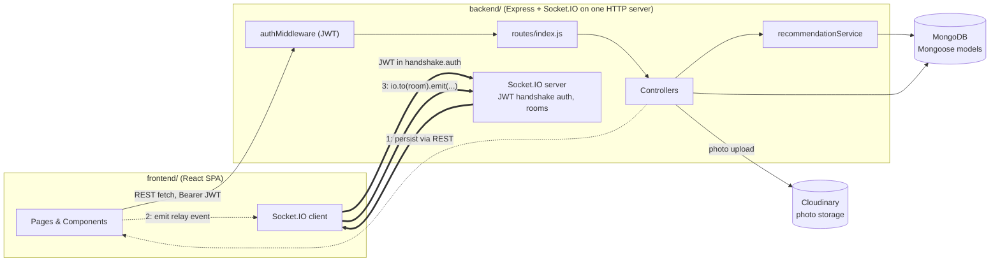

# Spark

A college-only dating platform where matching, chat, and a suite of real-time icebreaker games all run on a single MongoDB/Express/Socket.IO backend and a React 19 SPA — built around a multi-signal recommendation ranker and a consent-gated social-gaming layer ("Playroom") rather than a plain swipe deck.


## Demo / Screenshots

No hosted demo or screenshots are published in this repository yet. See [Local Development](#local-development) to run it and see it yourself — the app is a dark-mode, glassmorphism-styled SPA (`frontend/`) served against the Express API in `backend/`.

## Why This Project?

Spark's pitch is narrow on purpose — "no strangers, no random swipes, only verified students from your college" — which pushes most of the interesting engineering into two places most swipe-deck tutorials skip entirely:

- **Ranking who actually shows up in your feed.** Discovery isn't just "opposite gender preference, not yet swiped." A separate recommendation service scores every mutual-preference candidate on four independent signals (interests/traits/major overlap, collaborative "people who liked who you liked," swipe-behavior stats, and geographic distance) and blends them into a single ranked list — see [Recommendation System](#recommendation-system).
- **Real-time, stateful, multiplayer mini-games between exactly two matched users.** The "Playroom" isn't a chat widget — it's three distinct turn-based/consent-gated games (a dare-roulette wheel, a collaborative story, a blind-then-revealed "Would You Rather") each with their own Mongoose-modeled session state, synced live over Socket.IO rooms scoped per match. See [Real-Time Architecture](#real-time-architecture) and [Games / Playroom](#games--playroom).

Alongside that: idempotent match creation under concurrent swipes (backed by database-level unique indexes, not application-level locking), a deterministic per-user-per-day feed shuffle that pages without repeats or gaps, and a moderation-gated confession board ("Campus Pulse") with its own comment/reaction/poll system.

## Key Features

- **Authentication** — email/phone + password registration, bcrypt hashing, dual JWT (short-lived access + long-lived refresh) tokens, rate-limited OTP-based password reset.
- **Profile & Onboarding** — multi-field profile (interests, personality sliders, dating-intent, college, photos, geolocation), Cloudinary-backed photo uploads, an explicit `onboardingComplete` gate before the rest of the app unlocks.
- **Discovery feed** — paginated candidate feed with mutual gender-preference filtering, optional same-college and distance filters, and a stable per-day randomized ordering.
- **Recommendation / ranking system** — a separate, explicitly-scored candidate ranker (see below) beyond the raw discovery feed.
- **Swipe & matching** — like/pass, mutual-like match creation, race-safe idempotency, an "incoming swipes" inbox with explicit accept/reject.
- **Real-time chat** — per-match Socket.IO chat rooms with persisted message history.
- **Playroom social games** — Dare Roulette, Story Builder, and Would You Rather, gated behind a per-match "spice level," each with live-synced state.
- **Campus Pulse** — anonymous/named confessions with admin moderation, tag-based trending, comments, emoji reactions, and polls.
- **Gamification** — daily-login reward streaks and a notification/news-feed system.
- **Admin panel** — role-gated confession moderation UI.

## Recommendation System

`services/recommendationService.js` (`GET /api/recommendations/:userId`) is a separate ranking layer from the discovery feed — it exists specifically to answer "of everyone I *could* see, who's actually worth showing me first?"

**Candidate filtering** (before any scoring happens):
- Excludes yourself, everyone you've already swiped on, and existing active matches.
- Mutual gender preference: the candidate must match your stated preference, and you must match theirs (or they must be open to `'both'`).
- Age within **±3 years** of the viewer.
- Same `collegeId` as the viewer, when the viewer has one set — this is a hard filter (unlike the general Discover feed, where the same-college filter is opt-in via `?college=true`).

**Scoring** — each remaining candidate gets four independently-computed scores, normalized to `[0, 1]` and blended with fixed weights:

| Signal | Weight | What it measures |
|---|---|---|
| `contentScore` | 0.35 | Interest-list overlap (55%) + personality-trait overlap (30%) + same academic branch (15%) |
| `collaborativeScore` | 0.30 | "People who liked the same profiles you liked also liked this candidate" — a lightweight item-based collaborative-filtering signal built from `Swipe` records |
| `behaviorScore` | 0.25 | The candidate's own like-ratio and swipe-activity volume, plus a small boost if you've already viewed them |
| `contextScore` | 0.10 | Haversine great-circle distance between the two profiles' coordinates (manually implemented, not a library) + branch match |

The four scores are combined as `0.35·content + 0.30·collaborative + 0.25·behavior + 0.10·context`, and the full breakdown (not just the final number) is returned in the API response — useful for debugging *why* someone ranked where they did. Because `collaborativeScore` and `behaviorScore` are derived entirely from real `Swipe` history, they're `0` for any user (or whole dataset) with no swipe activity yet — the ranking becomes meaningful as usage accumulates, which is itself a realistic cold-start property rather than a bug.

## Real-Time Architecture

A single Socket.IO server is attached to the same HTTP server as the Express app (`app.js`). Every socket connection is authenticated up front:

```js
io.use((socket, next) => {
  const token = socket.handshake.auth.token;      // JWT, same one used for REST auth
  const decoded = jwt.verify(token, getJwtSecret());
  socket.userId = decoded.userId;
  next();
});
```

There's no anonymous or unauthenticated socket — a connection without a valid access token is rejected before `connection` even fires.

**Rooms are scoped per conversation/session, not global:**

| Room pattern | Joined via | Used for |
|---|---|---|
| `chat:<matchId>` | `join:chat` | 1:1 match chat |
| `story:<storySessionId>` | `join:story` | Story Builder |
| `wyr:<wyrSessionId>` | `join:wyr` | Would You Rather |
| `dare:<drSessionId>` | `join:dare` | Dare Roulette |

**Client-driven relay pattern.** Outside of chat (where the server itself persists `Message` documents on `message:send`), the Playroom games follow a deliberate pattern: the REST endpoint is the single source of truth and persists the action first; only after a successful response does the calling client emit a socket event, which the server does nothing but rebroadcast to the room (`io.to(room).emit(event, data)`). No socket handler independently mutates game state. This keeps "what happened" logic in one place (the controllers) and the socket layer as pure live fan-out.

**Resume behavior differs by game.** Story Builder and Would You Rather both fetch their full current state via a `GET` endpoint on mount, so reloading mid-game or joining late still shows the correct state — the socket relay is just for live updates on top of that. Dare Roulette has no such fetch-on-mount endpoint; its client-side state is built up purely from live relay events, so a page reload mid-round currently loses the client's view of that round even though the session is still open server-side (see [Known Limitations](#known-limitations)).

## Games / Playroom

A `Playroom` document is created per match (`isActive`, `spiceLevel` 1–5, `unlockedFeatures`). Starting a game creates a generic `PlayroomSession` (tracks `gameType`, `status`, `currentRound`, `currentTurnUserId`) plus a game-specific sub-session document:

- **Dare Roulette** — spin a 6-segment wheel (`dare` / `truth` / `challenge`); the server picks the landing category and persists a `DareSpin`. Both matched users must explicitly consent (`DareConsent`) before the actual `DareCard` text is revealed to either side — the reveal is gated on *both* consents existing, not just the requester's. Each user gets a per-session skip-token allowance (`skipTokensUser1/2`), and a completed dare can be rated 1–5 by the other participant.
- **Story Builder** — turn-based collaborative sentence-by-sentence story with a chosen `vibe` (romantic / funny / spicy / adventure) and a max length; turn order alternates via `currentTurnUserId`; either side can like a line; a completed story can be exported as an image through an existing Puppeteer-backed endpoint (`POST /story/:id/export`).
- **Would You Rather** — each side answers a seeded A/B question independently; an answer stays hidden (`isRevealed: false`) until *both* users have answered the same question, at which point both are revealed simultaneously along with a running "sync score" and a badge (e.g. "🔥 Perfect Sync") once enough answers match.

`PlayroomScore` tracks per-user tallies (dares completed, truths answered, story entries, WYR answers) for the match.

## Tech Stack

| Layer | Technology |
|---|---|
| Frontend | React 19, TypeScript, React Scripts (CRA), Socket.IO client |
| Backend | Node.js, Express 4 |
| Real-time | Socket.IO 4 (JWT-authenticated handshake, room-based) |
| Database | MongoDB via Mongoose 7 (2dsphere geo index, compound/partial unique indexes) |
| Auth | JWT (`jsonwebtoken`), `bcryptjs` password hashing |
| File uploads | Multer (memory storage) → Cloudinary |
| Image generation | Puppeteer (Story export-as-image) |
| Testing | Jest, Supertest, `mongodb-memory-server` |
| Styling | Hand-written CSS + inline styles (no CSS framework) — dark-mode glassmorphism design system |

## Architecture

Two independent Node projects in one repository (`backend/`, `frontend/`) — no monorepo tooling, each has its own `package.json` and is installed/run separately.



## Data Model

Every `Profile` belongs to a `User` (auth/credentials live separately from profile data) and optionally references a `College`. Everything else radiates out from a `Match`:

```
User ──1:1── Profile ──*:1── College
User ──*──── Swipe ────*── User            (like/pass, unique per fromUser+toUser pair)
User ──*── Match ──*── User                (userIds[2], unique pairKey while active)
Match ──1:*── Message                       (real-time chat)
Match ──1:1── Playroom ──1:*── PlayroomSession ──1:1── {DareRouletteSession | StorySession | WYRSession}
DareRouletteSession ──1:*── DareSpin ──1:*── DareConsent, DareCard ──1:*── DareCompletion
StorySession ──1:*── StoryEntry, StoryExport
WYRSession ──1:*── WYRQuestion ──1:*── WYRAnswer
Playroom ──1:*── PlayroomScore                (per-user tallies)
User ──1:*── Confession ──1:*── Comment, Reaction
User ──1:*── Poll
User ──1:1── Reward                           (daily streak)
User ──1:*── Notification
```

Key integrity decisions baked into the schema itself rather than only in application code:
- `Match.pairKey` (sorted, joined `userIds`) + a **partial unique index** scoped to `status: 'active'` — the database itself rejects a second active match for the same pair, even under concurrent requests.
- `Swipe` has a compound unique index on `(fromUserId, toUserId)` — a duplicate swipe request is a database-level no-op, not an application-level check.
- `Profile.location` uses a 2dsphere index for geo queries, and deliberately has **no default value** — a profile with no real location gets no `location` field at all, instead of a fake `[0, 0]` ("Null Island") that would silently look like a real place.

## API

All routes are mounted under `/api` (see `backend/routes/index.js`). Every route except registration/login/refresh/forgot-password/reset-password and the public profile-view endpoint requires `Authorization: Bearer <accessToken>`.

| Group | Endpoints |
|---|---|
| **Auth** | `POST /auth/register`, `/login`, `/refresh`, `/logout`, `/forgot-password`, `/reset-password` |
| **Profile** | `POST /profile`, `GET/PUT /profile/me`, `GET /profile/:userId` (public), `POST /profile/ai-assessment`, `POST/DELETE /profile/photos` |
| **Discovery** | `GET /feed`, `GET /recommendations/:userId`, `POST /swipe`, `GET /swipes/incoming`, `POST /swipes/:id/accept\|reject`, `GET /colleges/search` |
| **Matches & Chat** | `GET /matches`, `GET /matches/:matchId`, `GET /matches/:matchId/messages`, `POST /matches/:matchId/compatibility-test`, `DELETE /matches/:matchId` |
| **Playroom** | `GET /matches/:matchId/playroom`, `POST /matches/:matchId/playroom/activate`, `POST /playroom/:id/session`, `PATCH /playroom/:id/session/:sessionId/end`, `GET /playroom/:id/scores` |
| **Dare Roulette** | `POST /dare/:drSessionId/spin`, `POST /dare/spin/:spinId/consent`, `POST /dare/card/:dareCardId/complete`, `PATCH /dare/completion/:completionId/rate` |
| **Story Builder** | `GET /story/:storySessionId`, `POST /story/:storySessionId/entry`, `POST /story/:storySessionId/like/:entryId`, `POST /story/:storySessionId/export` |
| **Would You Rather** | `GET /wyr/:wyrSessionId`, `POST /wyr/question/:questionId/answer`, `PATCH /wyr/answer/:answerId/react` |
| **Campus Pulse** | `POST/GET/PATCH/DELETE /confessions`, `/confessions/trending`, `/confessions/pending` (admin), `/polls`, `/polls/:id/vote`, `/comments`, `/reactions`, `/stats/confessions`, `/tags/trending` |
| **Gamification** | `POST /rewards/claim`, `GET /rewards/me`, `GET /feed/news`, `GET/PATCH /notifications` |
| **Onboarding** | `POST /onboarding/complete` |

Malformed `ObjectId` route params are rejected with `400` by a shared `validateObjectIdParam` middleware before reaching a controller, rather than surfacing a raw Mongoose `CastError` as a `500`.

## Authentication & Security

- **Password hashing** — `bcryptjs`, 10 salt rounds, used identically for registration, password reset, and the dev seed script.
- **JWT** — short-lived access tokens (15 min) and longer-lived refresh tokens (7 days), signed with two separate secrets. Both secret getters (`getJwtSecret`/`getRefreshSecret`) live in one module (`utils/tokenService.js`) so REST auth and the Socket.IO handshake can never verify against different secrets. In production, the server **refuses to start** if `JWT_SECRET`/`REFRESH_TOKEN_SECRET` aren't set, rather than silently falling back to a hardcoded dev secret.
- **Authorization** — role-based (`User.role: 'user' | 'admin'`), centralized in `utils/adminAuth.js` and a `requireAdmin` middleware, replacing what used to be four separately hardcoded admin-email whitelists across different controllers. Ownership checks (a match participant, a swipe's recipient, a dare-consent participant, etc.) are enforced per-endpoint in the relevant controller.
- **Password reset** — OTP-based: a random 6-digit OTP (hashed with bcrypt before storage) plus a separate cryptographically random reset token; rate-limited to 3 requests/hour per email/phone; the OTP allows a maximum of 5 incorrect attempts before the reset token is invalidated; the entry is deleted on successful use (single-use, no replay). The OTP store is **in-memory** (`global.otpStore`) — see [Known Limitations](#known-limitations).
- **Input validation** — Mongoose schema validation (enums, required fields, min/max), a shared `validateObjectIdParam` middleware, coordinate/email/age/rating validators (`utils/validators.js`), and a centralized `errorHandler` that maps Mongoose validation errors, duplicate-key errors, JWT errors, and Multer upload errors to appropriate `4xx` responses instead of leaking a generic `500`.
- **File uploads** — Multer with in-memory storage, a 10 MB per-file limit, and a MIME-type allowlist (JPEG/PNG/WebP only) for profile photos, streamed directly to Cloudinary.

## Testing

Backend tests use **Jest + Supertest** against a real, isolated **`mongodb-memory-server`** instance per test file (`backend/tests/testDb.js`) — no shared or mocked database.

```bash
cd backend
npm test
```

This runs `jest --forceExit` (13 test files). Coverage includes: registration/login/token verification, IDOR/authorization boundaries (playroom session and dare-consent ownership checks), swipe→match idempotency under repeated and near-concurrent duplicate requests, admin-role migration and authorization, recommendation scoring (collaborative/behavior factors are non-zero given real swipe activity), profile/onboarding validation (including the "never default to `[0,0]`" location rule), comment author-name resolution, reaction toggling, rate-limited password reset, and the Playroom/Would-You-Rather reveal-gating logic (a partner's answer is never exposed before both sides have answered).

> The test runner's default parallel workers can be flaky on some machines because each file spins up its own in-memory MongoDB instance and they contend for resources; if you see spurious failures, run `npx jest --forceExit --runInBand` instead.

The frontend has `react-scripts test` available, but the only test present (`src/App.test.tsx`) is the unmodified Create React App scaffold test and currently fails against the actual app — see [Known Limitations](#known-limitations).

## Local Development

**Prerequisites:** Node.js 18+, a MongoDB connection string (local or Atlas), and optionally a Cloudinary account (photo uploads are disabled without one).

```bash
git clone https://github.com/Harsh-Pachauri/Spark.git
cd Spark
```

**1. Backend**

```bash
cd backend
npm install
cp .env.example .env   # then fill in the values below
npm run dev             # nodemon, http://localhost:5000
```

**2. Frontend** (in a second terminal)

```bash
cd frontend
npm install
npm start                # http://localhost:3000
```

**3. Run tests**

```bash
cd backend
npm test
```

### Environment variables (`backend/.env`, based on `.env.example`)

| Variable | Purpose |
|---|---|
| `MONGODB_URI` | MongoDB connection string |
| `JWT_SECRET` | Access-token signing secret (**required** in production) |
| `REFRESH_TOKEN_SECRET` | Refresh-token signing secret (**required** in production) |
| `CLOUDINARY_CLOUD_NAME` / `CLOUDINARY_API_KEY` / `CLOUDINARY_API_SECRET` | Photo upload storage (optional — uploads are disabled if unset) |
| `PORT` | API port (defaults to `5000`) |
| `NODE_ENV` | `development` / `production` |
| `FRONTEND_URL` | Documented for CORS/WebSocket origin purposes (currently unused by the code — see [Known Limitations](#known-limitations)) |
| `LOG_LEVEL` | Log verbosity (present in `.env.example`; not currently read by any code) |

Never commit a real `.env` — use `<your-value>` placeholders in any shared config, and copy `backend/.env.example` as your starting point.

The frontend reads one optional variable, `REACT_APP_BASE_URL` (defaults to `http://localhost:5000` if unset), pointing it at the backend API.

## Test Data / Seed Accounts

`backend/scripts/seedTestUsers.js` seeds 10 realistic, idempotent test accounts/profiles for local Discover/recommendation testing — email/password only, no fake `Swipe`/`Match` records.

```bash
cd backend
npm run seed:test-users
```

It creates (or updates in place, safe to re-run) 5 male and 5 female profiles with mixed gender preferences (including `'both'`), varied ages/interests/majors, real Cloudinary photo URLs, and 7 `College` documents — three same-city pairs deliberately share a college (recommendation scoring hard-filters to same-college candidates, so at least some pairs need to match on that). Every write is an upsert keyed by a stable field (`User` by email, `Profile` by `userId`, `College` by name), so running it repeatedly never creates duplicates. Test accounts are identified by a fixed email convention (`TestUser0N@gmail.com`) rather than a dedicated schema field, since none exists on `User`/`Profile`.

## Project Structure

```
Spark/
├── backend/
│   ├── app.js               # Express app + Socket.IO server + auth middleware
│   ├── server.js             # entrypoint
│   ├── config/                # database, cloudinary, multer connections
│   ├── controllers/           # one file per route group (auth, profile, discovery, playroom, dare, story, wyr, confession, ...)
│   ├── middleware/             # authMiddleware, requireAdmin, validateObjectIdParam, errorHandler
│   ├── models/                 # 30 Mongoose models
│   ├── routes/index.js         # all /api routes
│   ├── services/recommendationService.js
│   ├── scripts/seedTestUsers.js
│   ├── tests/                  # Jest + Supertest, mongodb-memory-server
│   └── utils/                   # tokenService, adminAuth, uploadService, validators
└── frontend/
    └── src/
        ├── components/
        │   ├── pages/           # Login, Register, Onboarding, Discover, Matches, Profile, CampusPulse, AdminPanel, ...
        │   ├── playroom/        # Playroom hub, DareRoulette, StoryBuilder, WouldYouRather
        │   └── sections/        # marketing/homepage sections
        └── utils/api.ts          # fetch wrapper, token storage
```

## Engineering Highlights

- **Database-enforced idempotency, not application-level locking.** Both duplicate-swipe and duplicate-active-match scenarios are prevented by unique indexes (`Swipe{fromUserId,toUserId}`, `Match.pairKey` with a partial filter on `status:'active'`) — concurrent requests collide at the database layer and the controller catches the `11000` duplicate-key error and returns the existing record instead of erroring.
- **Deterministic, stateless feed pagination.** The discovery feed shuffles candidates with a seeded PRNG (`mulberry32`, seeded by `userId + today's date`), so a viewer's feed order is stable across `page=1`/`page=2` requests within the same day (no repeats, no gaps) without persisting any "already shown" state, and naturally reshuffles the next day.
- **Multi-signal recommendation scoring with a transparent breakdown**, not a black-box number — see [Recommendation System](#recommendation-system).
- **A consistent client-driven Socket.IO relay pattern** applied uniformly across chat, story, WYR, and dare events, keeping persistence logic in exactly one place (the REST controllers) rather than duplicated across socket handlers — see [Real-Time Architecture](#real-time-architecture).
- **Consent modeled as data, not a client-side check.** A Dare Roulette card is only revealed once *both* participants' `DareConsent` records exist server-side — a malicious or buggy client can't force an early reveal by skipping a confirmation dialog.
- **Fail-fast secret configuration.** The app refuses to boot in production without real JWT secrets, rather than silently signing tokens with a well-known fallback.
- **Centralized admin authorization**, replacing four independently-drifted hardcoded email whitelists with one `User.role`-based check.
- **A geospatial 2dsphere index paired with a manual Haversine implementation** — `$geoNear` for the DB-side distance filter/sort in Discovery, plain trigonometry for the recommendation service's distance *score* — rather than reaching for an external geo library for a single formula.
- **Tests written around real concurrency bugs**, not just happy paths — e.g. a dedicated test asserting that near-simultaneous duplicate swipe requests still produce exactly one match and one notification pair, run against a real (in-memory) MongoDB rather than mocks.

## Known Limitations

- **CORS is fully open.** Both the Express `cors()` middleware and the Socket.IO server's CORS handler accept any origin (`callback(null, true)`), despite `FRONTEND_URL` being present in configuration — it isn't actually read anywhere in the code.
- **The password-reset OTP store is in-memory** (`global.otpStore`), so it doesn't survive a server restart and isn't shared across multiple backend instances — noted directly in the source as a known constraint of the current single-instance deployment.
- **No refresh-token revocation.** `logout` clears the user's FCM token but does not blacklist the refresh token; a leaked refresh token remains valid until it expires (7 days).
- **OTP delivery isn't wired up.** `forgotPassword` logs the OTP to the server console instead of sending a real email/SMS — there's no Nodemailer/Twilio integration despite `nodemailer` being a dependency.
- **View-based recommendation boosting is inert.** The `Interaction` model (and the `viewedIds` lookup that reads from it) exists, but nothing in the codebase ever writes an `Interaction` document — the small "already viewed" boost in `behaviorScore` is currently always `0`.
- **Dare Roulette has no resume-state endpoint.** Unlike Story Builder and Would You Rather (which `GET` full state on mount), Dare Roulette's client state is built entirely from live socket events — reloading mid-round loses the client's view of that round even though the session is still active server-side.
- **An unused AWS S3 config module exists** (`config/aws.js`) but is never imported anywhere; all uploads go through Cloudinary only.
- **No CI pipeline** is configured in this repository.
- **Frontend automated test coverage is effectively absent** — the only test file present is the default, unmodified Create React App scaffold test, and it currently fails against the redesigned app.

## Future Improvements

*(Not implemented — ideas only, based on the current architecture.)*

- Move the OTP store to Redis or a TTL-indexed Mongo collection to support multi-instance deployment and survive restarts.
- Restrict CORS to `FRONTEND_URL` in production instead of allowing any origin.
- Add refresh-token revocation (a blacklist or a rotating-token scheme) so `logout` actually invalidates a session.
- Wire up real OTP delivery (email/SMS) instead of a console log.
- Start recording `Interaction` documents so the recommendation service's view-boost signal becomes meaningful.
- Add a resume-state endpoint for Dare Roulette so reloading mid-round doesn't lose client-side state.
- Add a CI workflow that runs `npm test` (backend) on every PR.

## Contributing

No formal contribution guidelines exist in this repository yet. If you'd like to contribute, open an issue describing the change before submitting a pull request.
